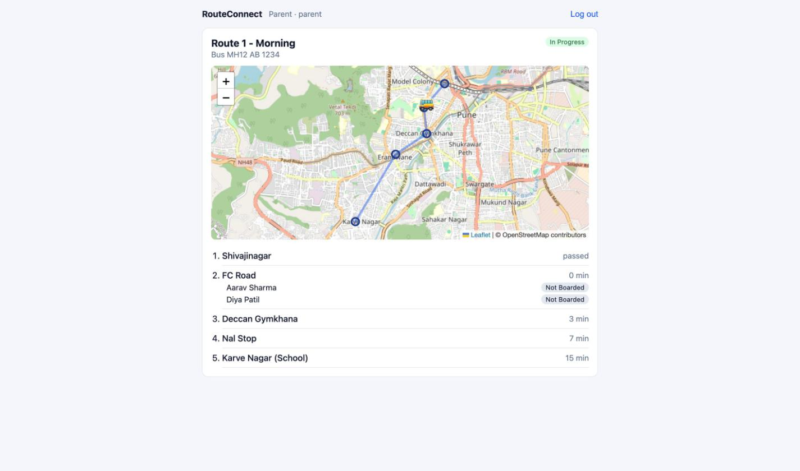

# RouteConnect

Live school-bus tracking. The conductor's phone shares the bus's GPS position, parents see
the bus move on a map with an ETA to their child's stop, and the conductor marks each child
as boarded or dropped.



## Stack

| Layer | Technology | Why |
|---|---|---|
| Backend | Python, Django 5.2 | Models, admin panel, auth and migrations come built in |
| REST API | Django REST Framework | JSON endpoints, token auth, input validation |
| Real-time | Django Channels + Daphne (ASGI) | WebSockets, so the server can *push* bus positions |
| Database | SQLite | Zero setup; swap to PostgreSQL for production |
| Frontend | React 19 + Vite | Component UI, fast dev server |
| Maps | Leaflet + OpenStreetMap | Free map tiles, no API key |
| ETA | Google Routes API | Real road times with live traffic; one call per trip |
| GPS | Browser Geolocation API | The conductor's phone becomes the bus tracker |

## Run it

You need Python 3.11+ and Node 18+.

```bash
# 1. Backend (terminal 1)
cd backend
python3 -m venv .venv
source .venv/bin/activate          # Windows: .venv\Scripts\activate
pip install -r requirements.txt
python manage.py migrate
python manage.py seed               # demo school, route, students, users
export GOOGLE_MAPS_API_KEY=your-key  # optional: real-traffic ETAs (Windows: set GOOGLE_MAPS_API_KEY=...)
python manage.py runserver          # http://127.0.0.1:8000 (HTTP + WebSocket)

# 2. Frontend (terminal 2)
cd frontend
npm install
npm run dev                         # http://localhost:5173
```

Demo logins (password `pbl12345` for all): `admin`, `conductor`, `parent`.

**To demo live tracking:** open the conductor in one browser and the parent in another
(or an incognito window, since a browser keeps one login per site). As the conductor:
**Start trip** → **Simulate drive**. The bus moves on the parent's screen.

Without a Google key everything still works; ETAs use a straight-line estimate instead.
The key needs the **Routes API** enabled in Google Cloud.

Django admin panel: http://127.0.0.1:8000/admin/ (log in as `admin`).

## Tests

```bash
cd backend && python manage.py test transport
```

Covers the ETA maths, the Google Routes API call (mocked, so tests cost nothing), login, role permissions, parent privacy, and a WebSocket test where
a conductor's location reaches a parent.

## Layout

```
backend/
  routeconnect/      project config: settings, URL routing, ASGI entry point
  transport/         the app
    models.py        database tables
    serializers.py   model <-> JSON
    permissions.py   who can see which route
    views.py         REST API
    consumers.py     WebSocket handler (live location)
    eta.py           Google Routes API call + ETA maths
    tests.py
    management/commands/seed.py   demo data
frontend/src/
  App.jsx            login state, loads routes
  Login.jsx
  RouteView.jsx      map + stops + students, listens on the WebSocket
  ConductorPanel.jsx start/end trip, sends GPS
  api.js             fetch + WebSocket helpers
```

See [docs/EXPLAINER.md](docs/EXPLAINER.md) for a full walkthrough.
